<div align="center">
  <h1>kon</h1>
  <h3>by shadow</h3>
  <h3>total time spent : 46 hours </h3>
</div>

--- 

### journal #1 the idea  
time spent : 1.5 hours   

  
ok so i read a LOT on my phone, mostly manga and random pdfs, and my eyes are always dead after like an hour. e-ink fixes that since it doesnt shine light at you, it just looks like paper. so the plan is to make my own e-reader from scratch, my own board, my own case, everything  
  
what i want: a 4ish inch e-ink screen, books on a microsd, 4 buttons, a lipo that charges over usb c, an actual on/off switch and a 3d printed case so it doesnt look like a naked pcb lol  
  
named it kon. no deep meaning, i just like how it sounds
  

<div align="center">
  
| what it ended up looking like |
| --- |
| 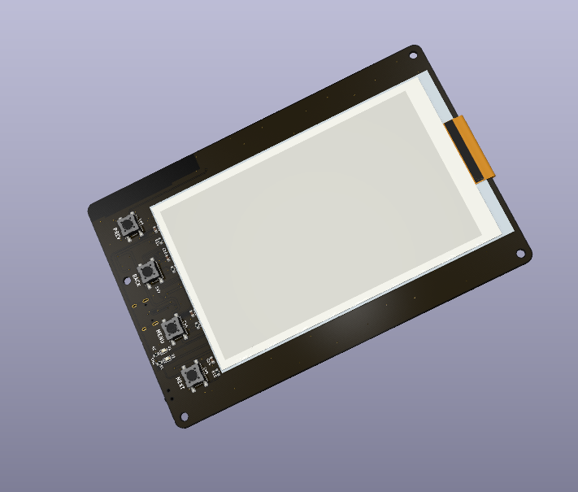 |

</div>

--- 

### journal #2 which chip  
time spent : 1.5 hours   

  
spent way too long on this. first thought was the rp2040 since i've used it a bunch, but no wifi, and i kinda want to send books to it wirelessly someday. the esp32-c3 is cheap but doesnt have much ram, and an 800x480 screen buffer alone is 48KB  
  
so ESP32-S3-WROOM-1-N16R8 it is. 16MB flash, 8MB psram, native usb (no ch340 needed yay), and its a module so the antenna and all the rf stuff is already done for me. the deep sleep on it is also really good which matters a lot for something running on a battery
  

<div align="center">
  
| the esp32-s3 in the schematic |
| --- |
| 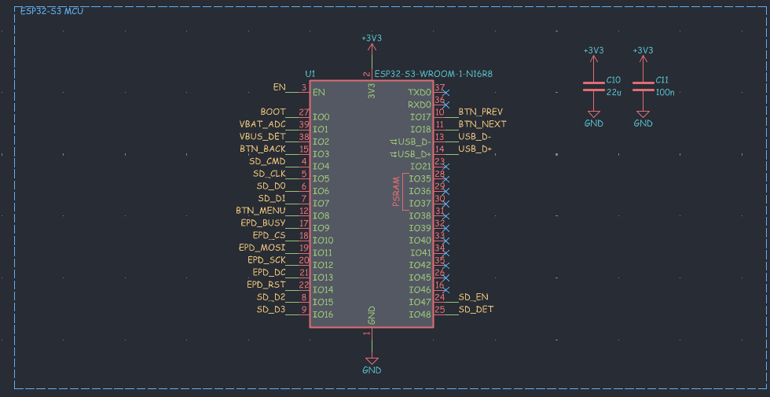 |

</div>

--- 

### journal #3 which screen  
time spent : 1.5 hours   

  
most of the cheap e-ink screens are 2.9 or 4.2 inch and like 400x300, and text on those looks kinda crunchy. found the GDEY0426T82 from good display, 4.26 inch and 800x480, which is way sharper. its about the size of a small paperback page which is perfect  
  
it uses the SSD1677 controller and GxEPD2 already supports it, so i dont have to write a display driver (thank god). the annoying part is its just a bare panel on a ribbon cable, no driver board, so i have to build the high voltage stuff for it myself. more on that later because it was a pain
  

<div align="center">
  
| the pcb with the screen on it |
| --- |
| 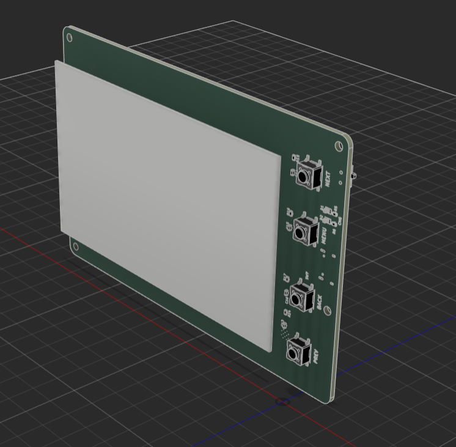 |

</div>

--- 

### journal #4 planning the schematic  
time spent : 1 hour   

  
this one has way more going on than my usual boards so before drawing anything i split it into boxes on paper: usb, charger, power switch + ldo, battery sensing, esp32, reset/boot, buttons, e-paper, microsd and mounting holes. then i did one box at a time and only joined them with net labels. took a bit longer upfront but it saved me a lot of scrolling around later
  

<div align="center">
  
| how the full schematic ended up |
| --- |
| 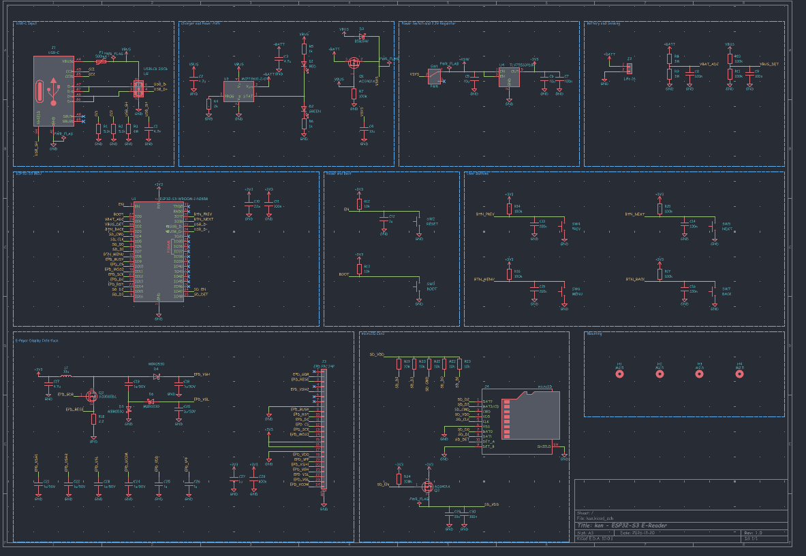 |

</div>

--- 

### journal #5 usb c  
time spent : 1 hour   

  
standard usb c stuff, i've done this enough times now that it went pretty fast. 5.1k on both CC pins (so c to c cables actually give power), the D+ and D- pairs tied together so it works both ways, no connect on SBU, and a 500mA polyfuse on vbus
  

<div align="center">
  
| usb c |
| --- |
| 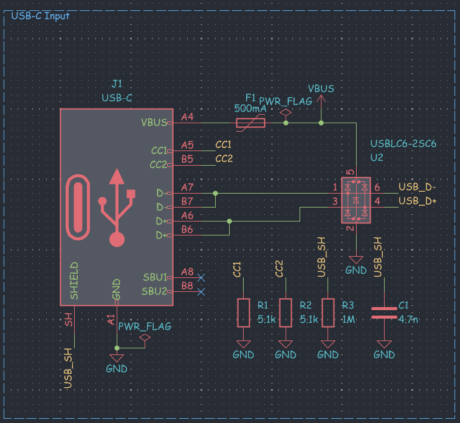 |

</div>

--- 

### journal #6 esd and the shield thing  
time spent : 1 hour   

  
USBLC6-2SC6 on the data lines like always, since this is going to get plugged and unplugged a ton  
  
tried something new with the shield though. on my other boards i just tied the metal usb shell straight to ground, but i read that you're supposed to go through a 1M resistor and a small cap (4.7nF here). static still drains away through the resistor and noise goes through the cap, but you dont get a ground loop if your laptop is noisy. not sure how much it matters on a tiny board like this but it costs like 2 cents so why not
  

<div align="center">
  
| usb esd and shield |
| --- |
|  |

</div>

--- 

### journal #7 charging the battery  
time spent : 1.5 hours   

  
battery is a 1 cell lipo on a jst ph connector. for charging i used the MCP73831, which is the same one in like every adafruit board, it handles the whole charge by itself and stops at 4.2v  
  
the charge current is set with one resistor on PROG (1000 / R). went with 2k so its 500mA, fast enough but safe for anything 1000mAh and up. 4.7uF on both sides
  

<div align="center">
  
| charger |
| --- |
| 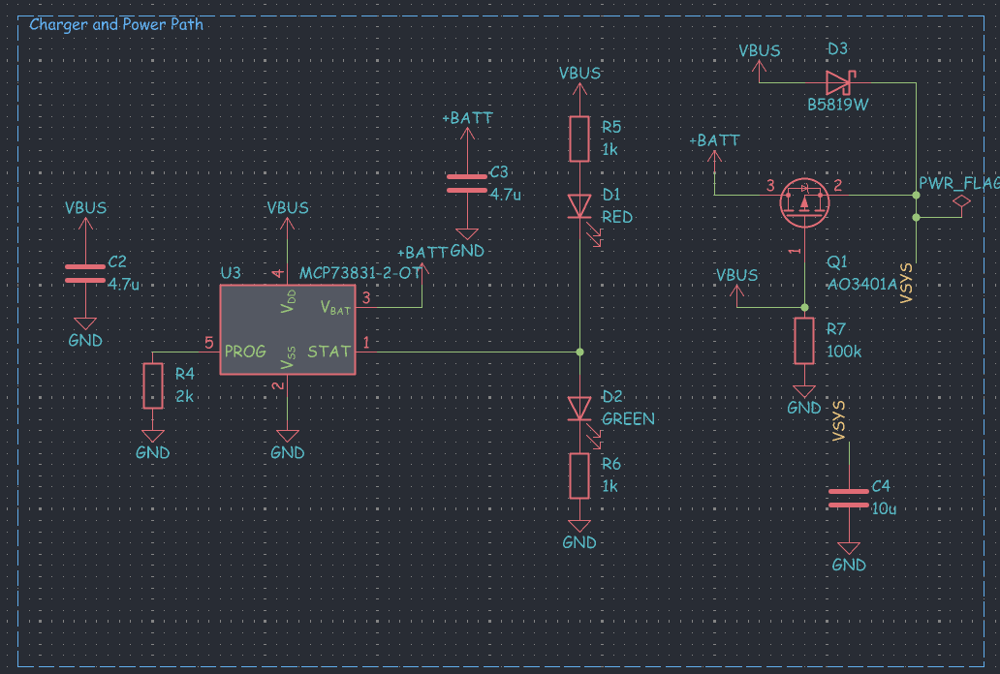 |

</div>

--- 

### journal #8 charge leds  
time spent : 0.5 hours   

  
small one. the STAT pin goes low while charging and high when done, so a red led from vbus to STAT lights up while its charging and a green one from STAT to ground lights up when its full. took me a minute to figure out the green one doesnt need its own pin lol. both off when usb is unplugged so they dont eat battery
  

<div align="center">
  
| charge leds |
| --- |
|  |

</div>

--- 

### journal #9 the power path (took forever)  
time spent : 1.5 hours   

  
the problem: when usb is plugged in i want the board running off usb and the battery just charging. when its unplugged the battery should take over. if you just connect everything together the charger gets confused because the board is draining the battery while it tries to charge it  
  
what i ended up doing is vbus goes through a B5819W diode into VSYS, and the battery goes into VSYS through an AO3401A p-mosfet. the mosfet gate has a 100k to ground so its normally on, but vbus is also on the gate. plug in usb, gate goes high, mosfet turns off, battery is cut off from the load and only charges. unplug, gate drops, mosfet turns on, battery runs everything  
  
i drew this out on paper like 4 times before it clicked
  

<div align="center">
  
| power path |
| --- |
|  |

</div>

--- 

### journal #10 power switch  
time spent : 0.5 hours   

  
PCM12 slide switch between VSYS and everything else. off means OFF, not even the regulator gets power. i put it after the charger on purpose so it still charges when its switched off
  

<div align="center">
  
| power switch and ldo |
| --- |
| 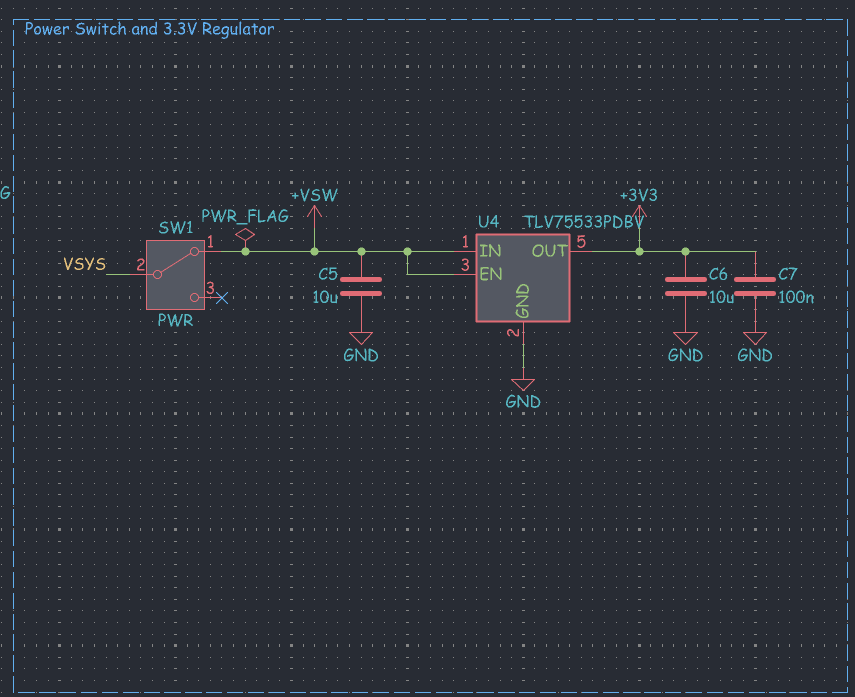 |

</div>

--- 

### journal #11 the 3.3v regulator  
time spent : 1 hour   

  
normally i'd just throw an AP2112K in, but its dropout isnt great and a lipo spends a lot of its life around 3.6 to 3.7v. went with the TLV75533 instead, it only drops about 200mV at 500mA so it keeps putting out a proper 3.3v until the battery is pretty much empty. it also barely draws anything itself (~25uA) which is nice for sleep. 10uF in, 10uF + 100nF out
  

<div align="center">
  
| ldo |
| --- |
|  |

</div>

--- 

### journal #12 battery % and usb detect  
time spent : 1 hour   

  
wanted a battery percent on screen, so the battery goes through two 1M resistors into an adc pin. a full 4.2v battery shows up as 2.1v which the esp32 can read. i used 1M because with smaller resistors the divider itself slowly drains the battery even when its off, with 1M its like 2uA  
  
same idea for usb, two 100k resistors from vbus to another pin so the firmware knows when its charging. 100nF on both because high resistance + adc = noisy readings
  

<div align="center">
  
| battery and sensing |
| --- |
| 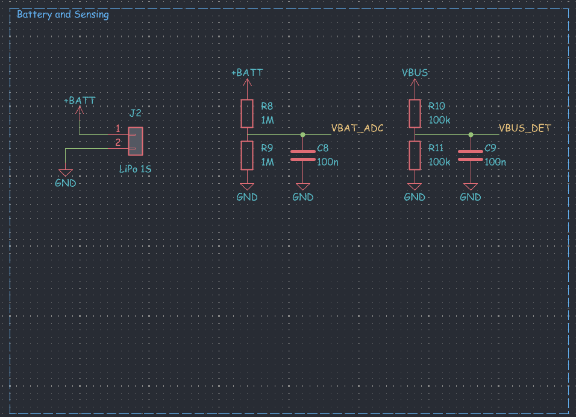 |

</div>

--- 

### journal #13 figuring out the esp32 pins  
time spent : 2 hours   

  
this took way longer than i thought. on the s3 some pins are secretly used by the psram and flash inside the module, and some are strapping pins that mess with how it boots if you pull them the wrong way. i almost put a button on IO46 before reading that, would have been a fun bug to find later  
  
ended up with IO9 to 14 for the e-paper, IO4 to 7 plus 15 and 16 for the sd card, IO1 and IO2 for battery and usb detect, IO47 to switch the sd power and IO48 for card detect. the 4 buttons are on IO3, 8, 17 and 18, which i picked because theyre rtc pins, and only rtc pins can wake the chip from deep sleep. usb is stuck on IO19 and 20 anyway  
  
also a 22uF + 100nF right at the 3.3v pin because wifi pulls big spikes of current
  

<div align="center">
  
| esp32-s3 |
| --- |
|  |

</div>

--- 

### journal #14 reset and boot  
time spent : 1 hour   

  
EN gets a 10k pullup and a 1uF cap so it waits until the 3.3v is stable before starting, plus a reset button. BOOT (IO0) has a 10k pullup and its own button. hold boot, tap reset, and it shows up for flashing over usb. pretty much copied from the espressif dev board
  

<div align="center">
  
| reset, boot and buttons |
| --- |
| 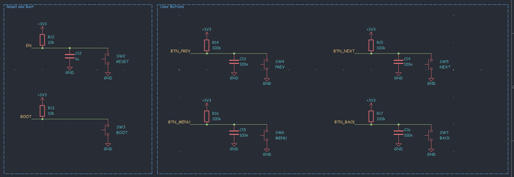 |

</div>

--- 

### journal #15 the 4 buttons  
time spent : 1 hour   

  
each button has a 100k pullup and a 100nF cap across it. the cap is for debouncing, on my macropad i didnt do this and one press would sometimes count twice, which on an e-reader would mean skipping pages, super annoying. 100k instead of 10k so they draw basically nothing in sleep  
  
used PTS645 switches because theyre tall enough to reach the button caps on the case
  

<div align="center">
  
| buttons |
| --- |
|  |

</div>

--- 

### journal #16 the e-paper boost circuit  
time spent : 2 hours   

  
ok this was the scary part. e-ink needs around +20v and -20v to push the ink particles around, and the panel doesnt make that itself, so the board needs a little boost converter that the screen controller runs  
  
its a 10uH inductor, an Si1308 mosfet that the controller switches really fast through the GDR pin, a 2.2 ohm resistor on RESE so it can sense the current, and three MBR0530 diodes that turn the spikes into the positive and negative rails. honestly i dont fully understand every part of it, i copied the reference circuit from the datasheet exactly and checked every value twice. if this is wrong the screen just stays white and theres no error or anything, so not the place to get creative
  

<div align="center">
  
| e-paper interface |
| --- |
| 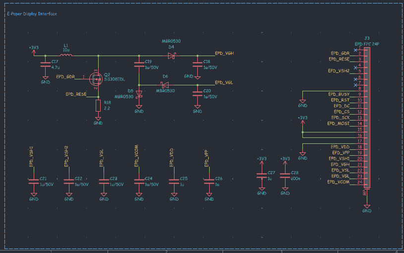 |

</div>

--- 

### journal #17 50v caps and the ribbon connector  
time spent : 1.5 hours   

  
every high voltage pin on the panel (VSH1, VSH2, VSL, VGH, VGL, VCOM) needs its own 1uF cap, and they HAVE to be 50v rated. i almost used my normal 0603 16v caps before noticing, those would just die at 20v. switched to 0805 50v ones  
  
then everything goes to a Hirose FH12 24 pin ribbon connector, 0.5mm pitch. i checked the pin order against the panel datasheet 3 times because if its mirrored nothing works and you'd never know why
  

<div align="center">
  
| e-paper fpc |
| --- |
|  |

</div>

--- 

### journal #18 microsd  
time spent : 1 hour   

  
most projects i've seen run the sd card in spi mode, but the s3 has a real sd host so i wired it in 4 bit mode instead (CLK, CMD, D0 to D3). its roughly 4x faster, which you'd notice when jumping through a big book. 10k pullups on all the data lines and CMD, the card wont start without them
  

<div align="center">
  
| microsd |
| --- |
| 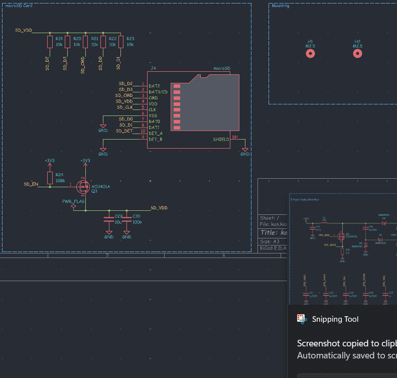 |

</div>

--- 

### journal #19 turning the sd card off  
time spent : 1 hour   

  
found out sd cards can pull a few mA just sitting there doing nothing, which would kill the battery in a couple days of sleep. so the card gets power through another AO3401A. 100k pullup on the gate means its off by default, the esp32 pulls SD_EN low when it actually needs the card. the slot (Hirose DM3AT) also has a card detect pin, so the firmware can tell you to put a card in instead of just crashing
  

<div align="center">
  
| sd power and detect |
| --- |
|  |

</div>

--- 

### journal #20 erc  
time spent : 1 hour   

  
titled all the boxes, cleaned up the labels, ran erc. the usual "power input not driven" errors on VSYS, VSW and VBUS, fixed with PWR_FLAGs, and some unused esp32 pins that needed no connect flags. took 3 or 4 runs to get it fully clean
  

<div align="center">
  
| final schematic |
| --- |
|  |

</div>

--- 

### journal #21 board shape and placement  
time spent : 1.5 hours   

  
84 x 128 mm, basically the screen size plus a border, with M2.5 holes in each corner. the screen sits on the back with its ribbon wrapping around to the connector, so the middle of the board stays empty  
  
buttons went along one side where your thumb is, esp32 in a bottom corner, usb c and the power switch and battery connector along the bottom, and the e-paper parts up top next to the ribbon connector. moved things around a bunch thinking about where they'd end up in the case
  

<div align="center">
  
| first placement |
| --- |
| 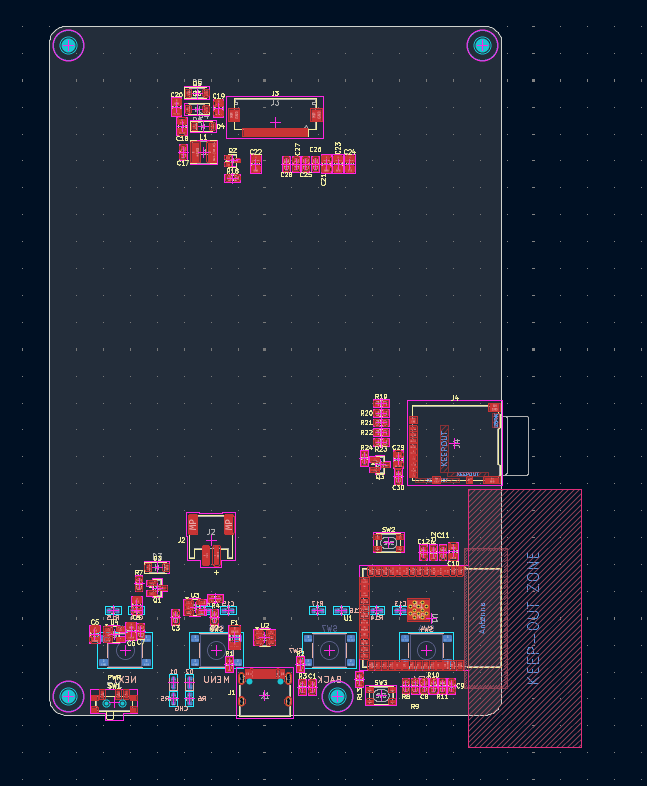 |

</div>

--- 

### journal #22 antenna keep-out  
time spent : 1 hour   

  
the esp32 antenna hates copper near it, the range drops a lot. so the antenna end of the module hangs off the edge of the board and theres a keep-out zone on both layers around it. had to nudge the module and a few parts around a couple of times to make it fit without the keep-out eating into the usb area
  

<div align="center">
  
| keep-out zone |
| --- |
| 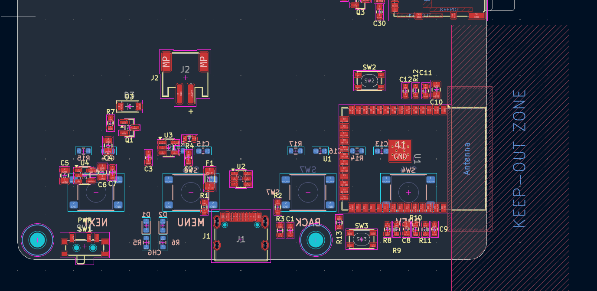 |

</div>

--- 

### journal #23 placing the e-paper and sd parts  
time spent : 1 hour   

  
the boost parts all went right next to the ribbon connector, inductor + mosfet + diodes in a tight group so the switching loop is tiny (less noise). the 50v caps in a row right under the pins they belong to. sd slot with its pullups lined up next to it and the power mosfet beside them
  

<div align="center">
  
| e-paper parts | microsd parts |
| --- | --- |
| 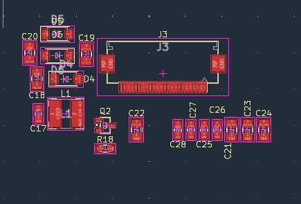 | 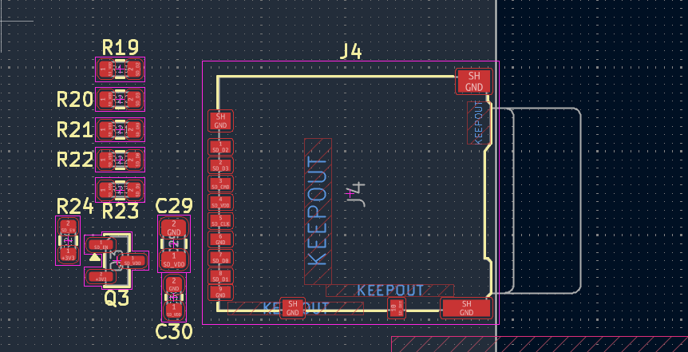 |

</div>

--- 

### journal #24 routing the sd card  
time spent : 2 hours   

  
started routing with the sd card and my first attempt was a mess, the mosfet traces were going everywhere. moved the pullups and the mosfet around and redid it, way cleaner the second time
  

<div align="center">
  
| first try | second try |
| --- | --- |
| 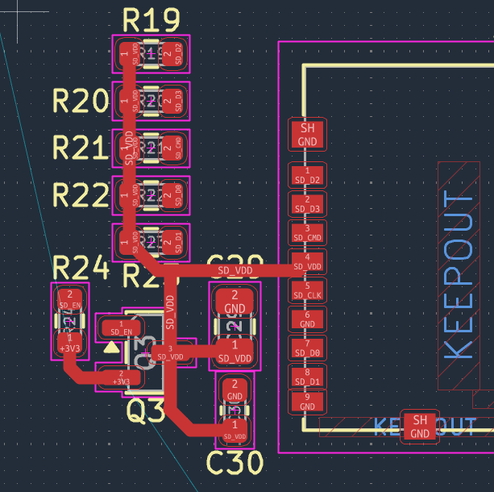 | 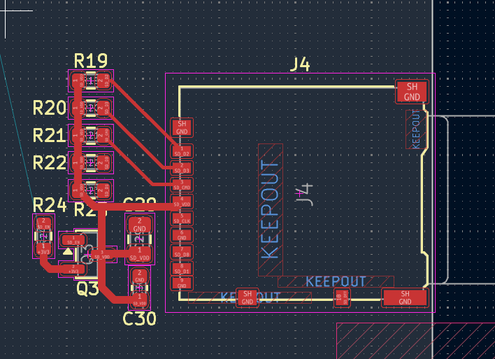 |

</div>

then the 6 lines all the way down to the esp32. tried to keep them roughly the same length and dropped a few to the bottom layer to get around the slot

<div align="center">
  
| sd done |
| --- |
| 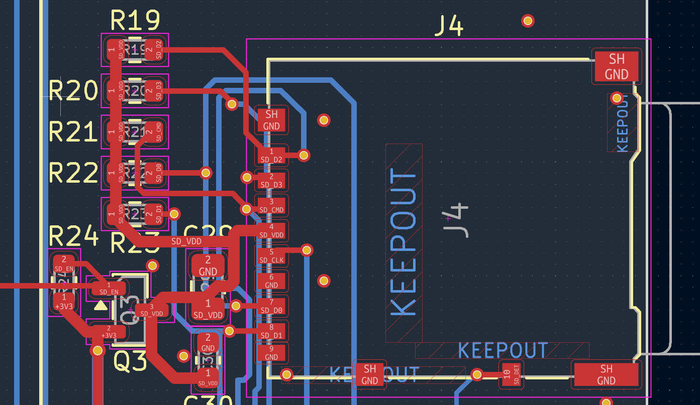 |

</div>

--- 

### journal #25 routing power  
time spent : 2 hours   

  
everything power related is along the bottom edge so i did it all in one go. usb, fuse, diode, charger, leds, battery connector, mosfet, switch, ldo. power traces are 0.5 and 0.6mm since the charger does 500mA and wifi spikes can go over 300mA. the sensing dividers were last and kinda squeezed in wherever there was space
  

<div align="center">
  
| starting | done |
| --- | --- |
| 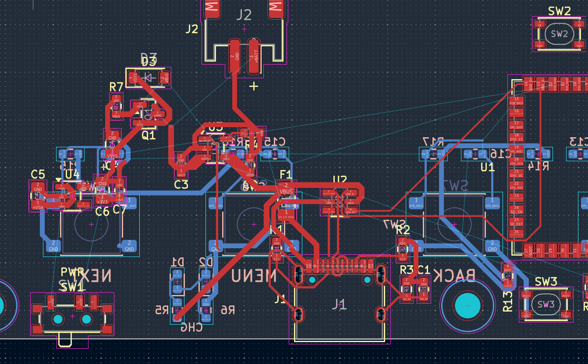 | 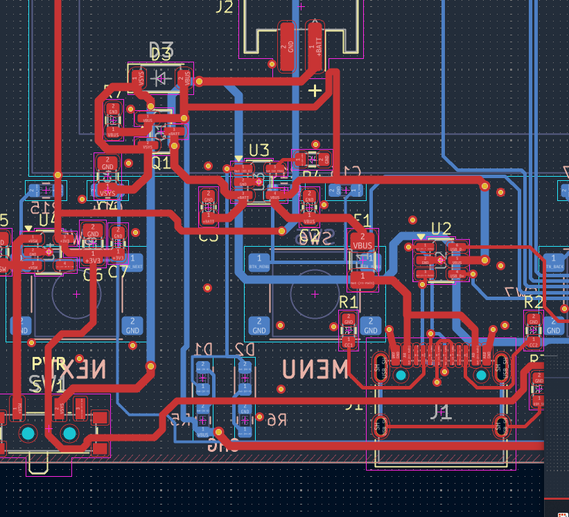 |

</div>

--- 

### journal #26 routing usb c  
time spent : 1 hour   

  
the usb c pads are SO small. zoomed in all the way, joined the D+ and D- pins right at the connector and ran them as a pair through the esd chip to the esp32 with no vias. CC lines out to their resistors and a fat vbus trace to the fuse
  

<div align="center">
  
| usb c pads |
| --- |
| 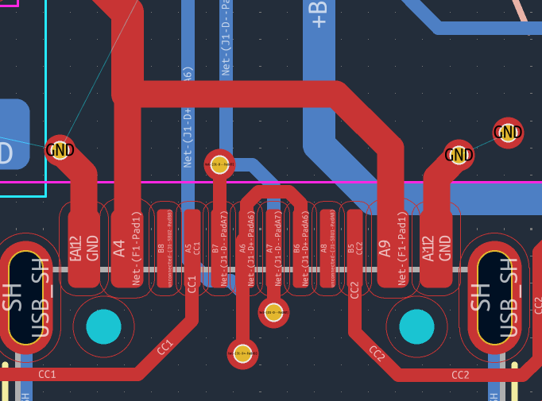 |

</div>

--- 

### journal #27 routing the e-paper  
time spent : 2 hours   

  
boost loop first, kept as tight as i could, then each high voltage pin to its cap. after that the 6 spi/control lines, which have to go the entire length of the board from the esp32 at the bottom to the connector at the top. ran them down the back as a neat little bundle. its probably my favourite looking part of the board tbh
  

<div align="center">
  
| starting | done |
| --- | --- |
| 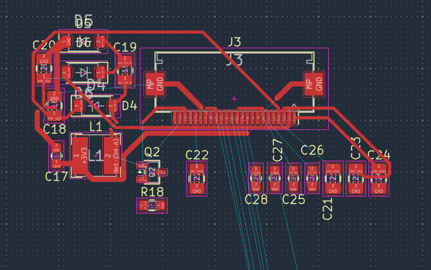 | 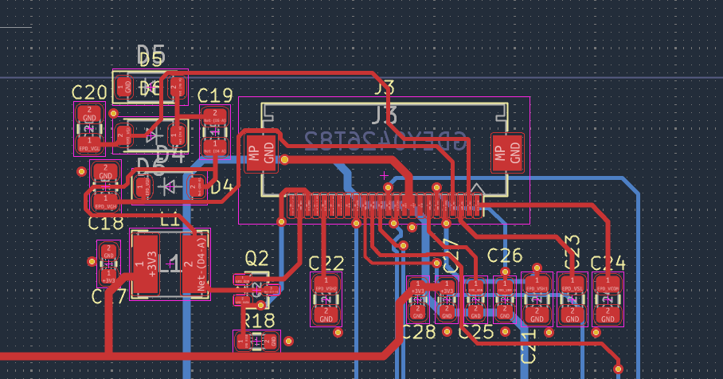 |

</div>

--- 

### journal #28 pours and drc  
time spent : 1.5 hours   

  
ground pour on both sides (not in the antenna keep-out), then stitching vias around the edges and the power area, 158 vias total. drc found a bunch of clearance errors around the usb c and the ribbon connector, both have tiny pads, so i spent a while nudging traces until it was happy
  

<div align="center">
  
| routed | top pour | bottom pour |
| --- | --- | --- |
| 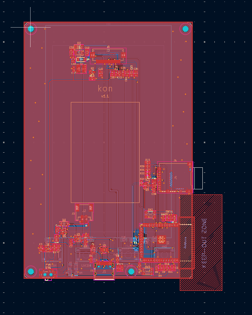 | 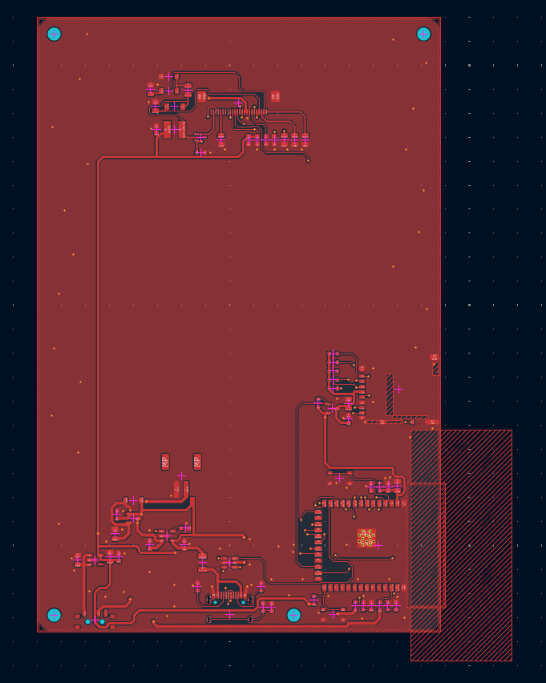 | 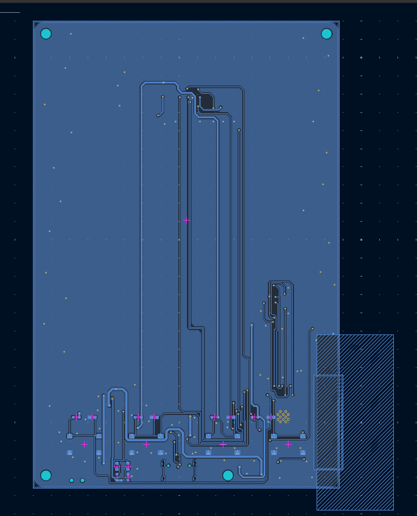 |

</div>

--- 

### journal #29 silkscreen and getting it quoted  
time spent : 1 hour   

  
put "kon v1.1" on the board and labels for the buttons, PWR and CHG. took some renders, then exported the gerbers, bom and position files and got a jlcpcb quote. 76$ for 2 assembled boards, a bit more than i hoped but the esp32 module and the connectors add up
  

<div align="center">
  
| back | front with the screen |
| --- | --- |
| 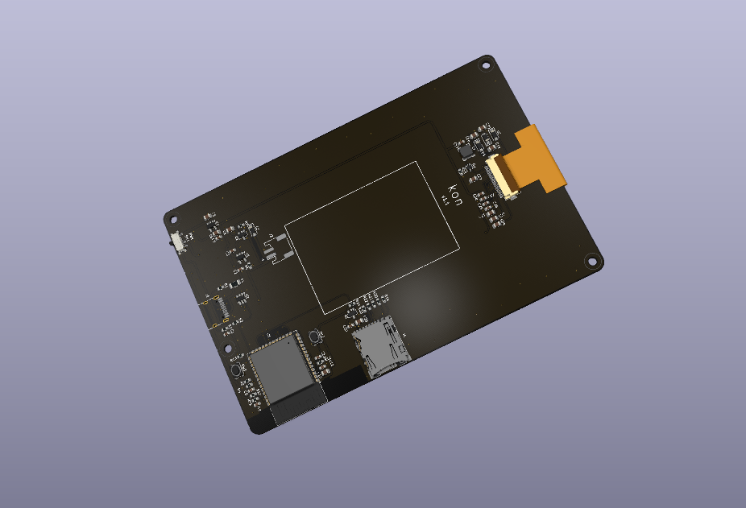 |  |

</div>

--- 

### journal #30 into fusion  
time spent : 1.5 hours   

  
case time! exported the board as a step with all the parts and pulled it into fusion. projected the outline and the 4 holes onto a sketch so the case lines up with the real board instead of me guessing measurements
  

<div align="center">
  
| pcb in fusion | back side |
| --- | --- |
| 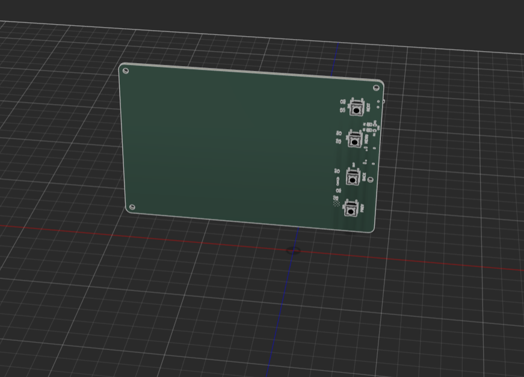 | 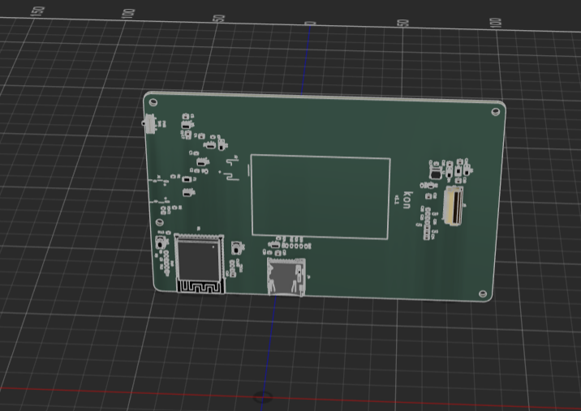 |

| projecting the outline |
| --- |
| 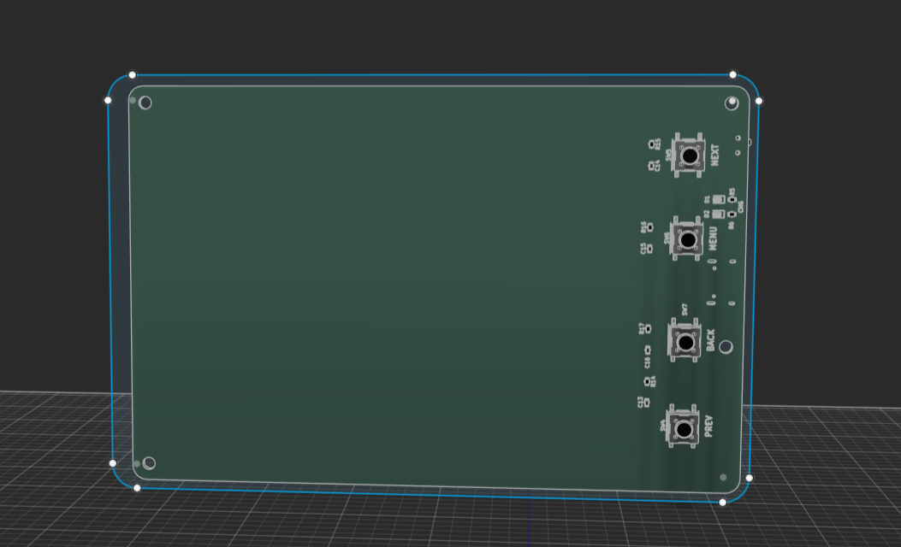 |

</div>

--- 

### journal #31 back tray  
time spent : 1 hour   

  
the back is a tray the board drops into, a little bigger than the outline so it doesnt rub. left room underneath for a flat lipo and added standoffs that line up with the mounting holes
  

<div align="center">
  
| the tray |
| --- |
| 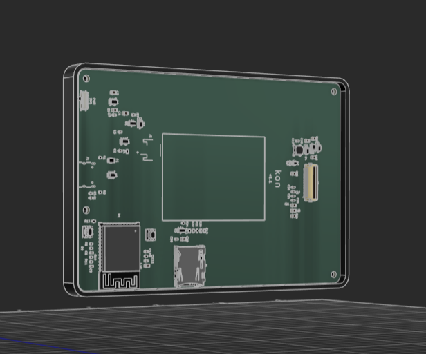 |

</div>

--- 

### journal #32 front frame and buttons  
time spent : 1.5 hours   

  
the front is a frame with a window for the screen, slightly smaller than the panel so you dont see the ugly edges. started with just the frame, added one button cap to see if it lined up with the switch (it didnt at first, was off by like a mm), fixed that and then did all 4
  

<div align="center">
  
| just the frame | one button | all four |
| --- | --- | --- |
| 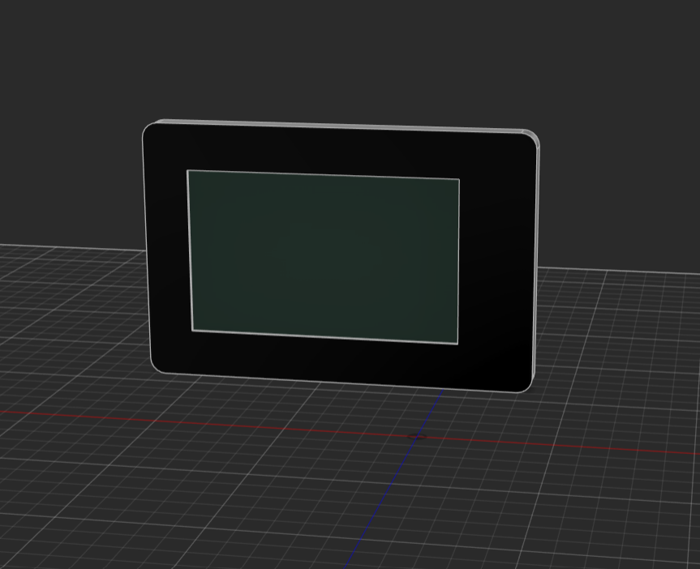 | 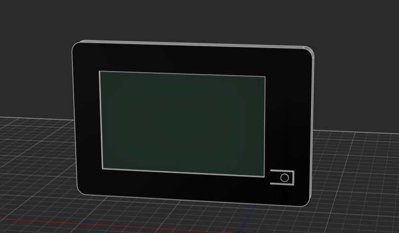 | 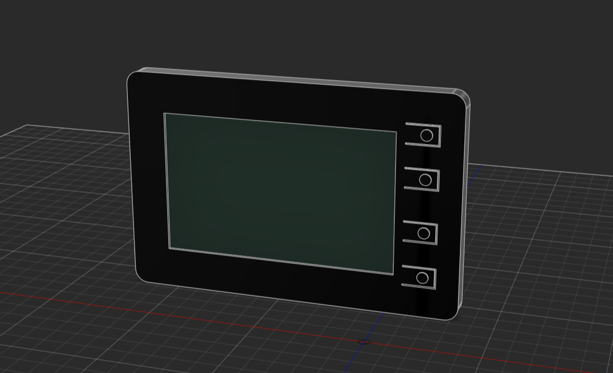 |

</div>

--- 

### journal #33 finishing the case  
time spent : 1.5 hours   

  
cut out the side for the usb c and the power switch, and put screw holes on the back that go all the way through to the board, so the whole thing is held together with just 4 screws. checked everything in the assembly and nothing was clipping, which honestly surprised me
  

<div align="center">
  
| side with the ports | back |
| --- | --- |
| 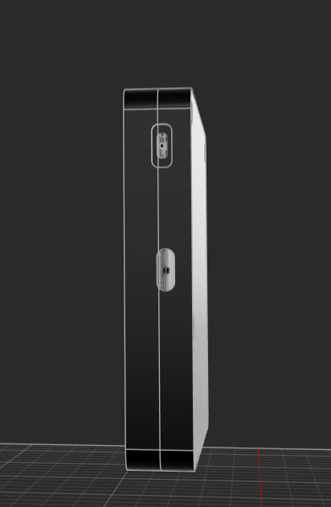 | 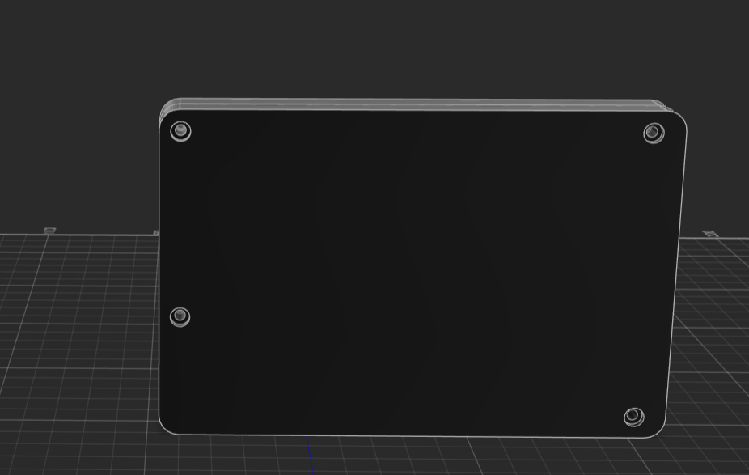 |

| in fusion |
| --- |
| 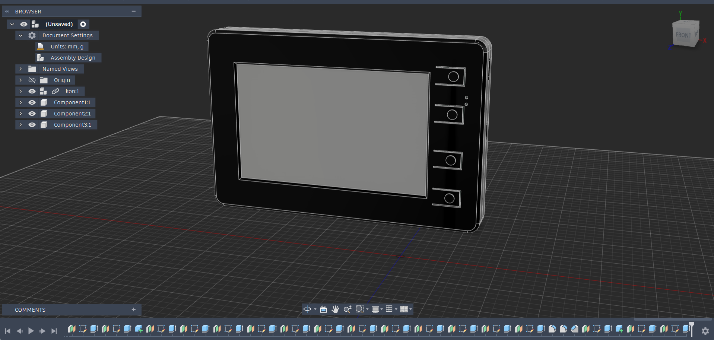 |
| 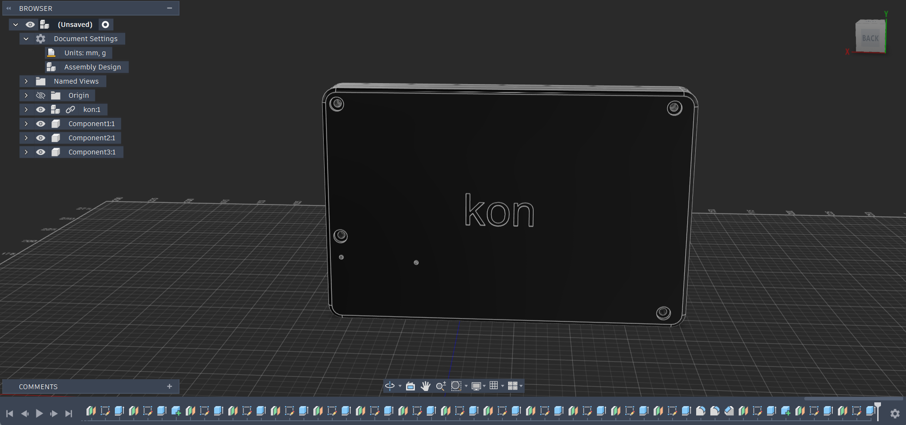 |

</div>

--- 

### journal #34 firmware part 1  
time spent : 1.5 hours   

  
started the firmware in arduino with the esp32 core and GxEPD2 for the screen. i used AI to help write the code, then went through all of it myself and checked every pin against my schematic. i dont have the board yet so its not tested, theres probably stuff ill need to fix when it arrives  
  
this part is the library screen. on boot it turns on the sd card, checks the card detect pin, starts it in 4 bit mode and makes a list of every .txt file on it. MENU brings up the list, PREV/NEXT move up and down, BACK opens the book. no card = it shows a message and goes back to sleep instead of crashing
  

<div align="center">
  
| the back with the logo |
| --- |
| 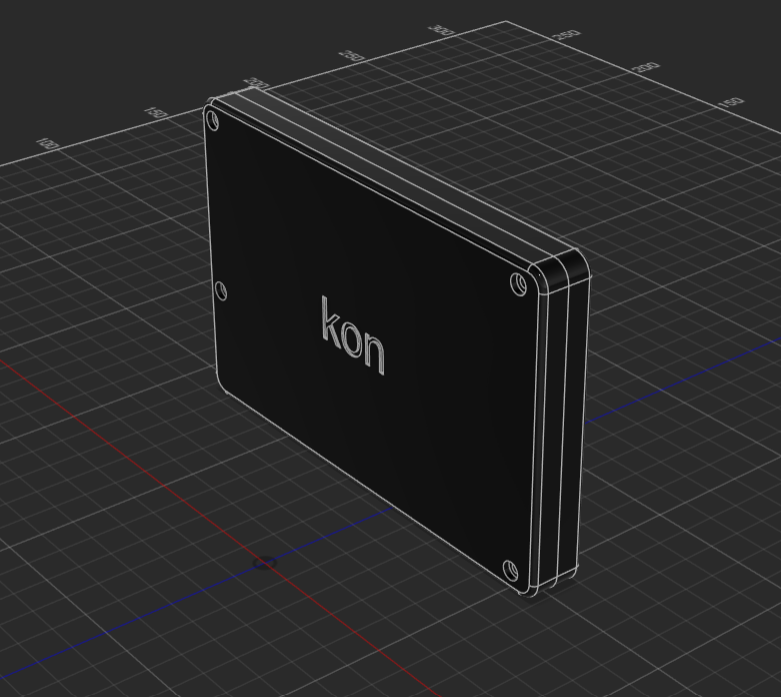 |

</div>

--- 

### journal #35 firmware part 2  
time spent : 2 hours   

  
the reading part. it goes through the book word by word, measures each word in the font and wraps the line when it gets too wide. it saves where each page starts so going back a page is instant, and it remembers your page for every book so it opens right where you stopped  
  
bottom of the screen has the book name, page number and battery %, with a + when its charging. if you dont press anything for 3 minutes (and its not plugged in) it turns off the sd card and goes into deep sleep, and any button wakes it up. the best part is the page stays on screen the whole time since e-ink doesnt need power to keep an image :D
  

```cpp
esp_sleep_enable_ext1_wakeup(mask, ESP_EXT1_WAKEUP_ANY_LOW);
```

<div align="center">
  
| kon |
| --- |
| 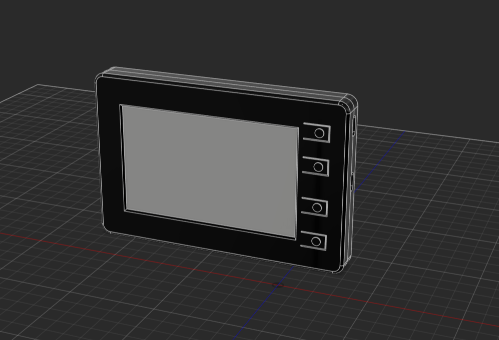 |
| 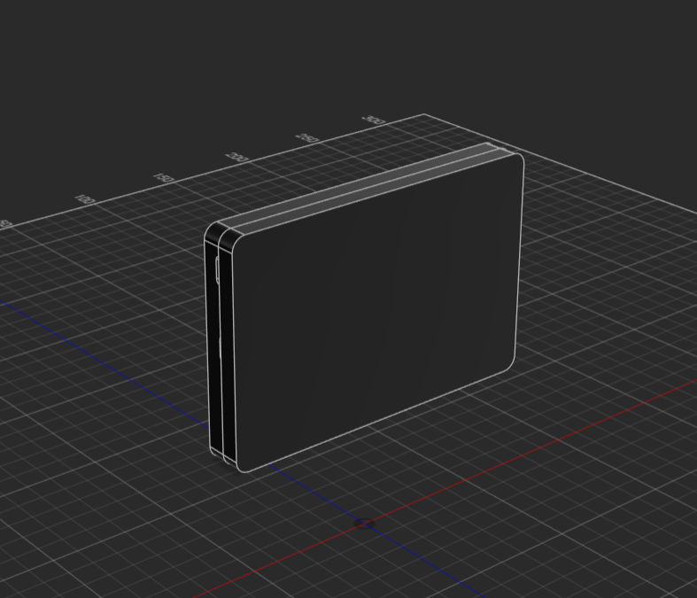 |

</div>

thats kon done! if you read till here, thank you :D
